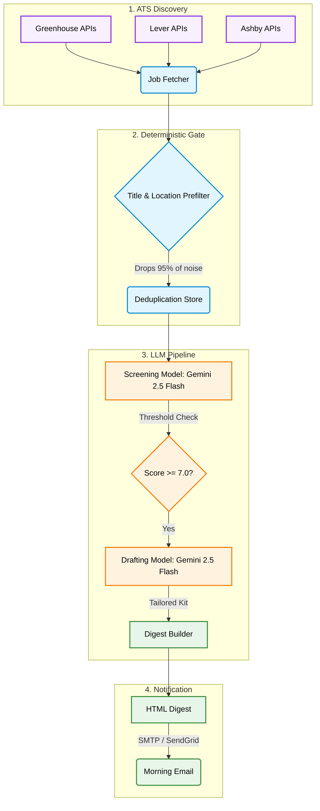

# JobHunt

An automated, agentic job-search pipeline that pulls from ATS boards, prefilters noise, scores matches against your resume using LLMs, and drafts tailored cover letters.

---

## Overview

JobHunt is an autonomous job-search assistant that ingests open positions directly from public ATS endpoints (Greenhouse, Lever, and Ashby), removes irrelevant postings through deterministic title and location rules, and evaluates remaining candidates against your resume using a two-stage LLM evaluation pipeline. High-affinity roles receive automatically tailored application packages, including concise cover letters and suggested interview talking points.

> By design, the system never auto-submits applications to prevent ATS domain blacklisting or unvetted submissions. It operates strictly as an intelligent research and drafting copilot.

---

## Architecture Overview



Deterministic regex prefiltering purges ~95% of out-of-scope postings before invoking any LLM, keeping monthly operational inference costs under ₹5/day.

---

## Features

| Feature | Description |
| ------- | ----------- |
| **Multi-ATS Integration** | Direct API ingestion from Greenhouse, Lever, and Ashby boards with schema normalization and HTML unescaping |
| **Two-Stage LLM Evaluation** | Stage 1 scores roles against resume criteria; Stage 2 generates 150-word cover letters and bullet points for top matches |
| **Deterministic Prefilter** | Fast regex-based title, function, and location exclusion rules defined in `config.yaml` |
| **Deduplication Store** | Local and cached `seen.json` state preventing repeated evaluation of previously processed roles |
| **Application Funnel Tracking** | CLI tracker mapping application funnel status into structured `out/tracker.csv` spreadsheets |
| **Automated Digests** | Generates standalone HTML digests and sends optional morning notification emails via SMTP |

---

## Technology Stack

| Component | Technology |
| --------- | ---------- |
| Language & CLI | Python 3.10+, argparse |
| LLM Provider | Google Gemini API (Flash models) |
| Configuration | YAML (`config.yaml`, `companies.yaml`) |
| Data Storage | Local JSON state (`seen.json`), CSV tracking |
| Testing & Quality | pytest, ruff |
| Automation | GitHub Actions (Cron workflows) |

---

## Project Structure

```
JobHunt/
├── jobhunt/
│   ├── cli.py             # Command-line entrypoint and commands
│   ├── fetcher.py         # ATS API crawlers (Greenhouse, Lever, Ashby)
│   ├── filters.py         # Deterministic regex filtering rules
│   ├── llm.py             # Gemini client, scoring, and cover letter synthesis
│   ├── mailer.py          # HTML digest rendering and email dispatch
│   └── store.py           # Deduplication state and persistence logic
├── tests/
│   ├── test_llm.py        # LLM prompt and schema validation tests
│   └── test_parsers.py    # ATS endpoint parsing and unescaping tests
├── companies.yaml         # Target company and ATS slug listings
├── config.yaml            # Role filters, score thresholds, and target locations
├── requirements.txt       # Production dependencies
├── ruff.toml              # Code formatting and linter configuration
└── README.md
```

---

## Setup and Installation

### Prerequisites

- Python 3.10+
- A [Google AI Studio Gemini API Key](https://aistudio.google.com/app/apikey)

### 1. Clone the repository

```bash
git clone https://github.com/Shashank17singh/JobHunt.git
cd JobHunt
```

### 2. Install dependencies

```bash
python -m venv .venv
# Windows:
.\.venv\Scripts\Activate.ps1
# Linux / macOS:
source .venv/bin/activate

pip install -r requirements.txt
```

### 3. Configure environment variables

```bash
cp .env.example .env
# Edit .env and supply your credentials:
# GEMINI_API_KEY=your_api_key_here
```

### 4. Generate your matching profile

Pass your resume (`.tex`, `.md`, or `.txt`) to synthesize your matching criteria:

```bash
python -m jobhunt profile --resume JobHunt_Resume.tex
```

Review and fine-tune the generated `profile.json` as necessary.

### 5. Execute the pipeline

Run an evaluation dry-run with a batch limit:

```bash
python -m jobhunt run --limit 10
```

To run full ingestion and dispatch the resulting email digest:

```bash
python -m jobhunt run --send
```

---

## Application Tracking

When submitting an application for a discovered role, log it into the tracking funnel:

```bash
python -m jobhunt applied "greenhouse:stripe:5501001"
python -m jobhunt stats
```

Application metrics and response rates are updated in `out/tracker.csv`.

---

## Running the Tests

Execute unit and integration tests with pytest:

```bash
pytest tests/
```

Run static code analysis and linting:

```bash
ruff check .
```

---

## Deployment

JobHunt is designed to execute as an automated headless cron task on GitHub Actions. The workflow runs on a daily schedule, pulls the latest ATS boards, evaluates candidates against `profile.json`, stores updated `seen.json` artifacts in GitHub Actions cache, and emails the digest.

---

## Operational Considerations & Limitations

- **Public ATS Scope**: Ingestion focuses on publicly discoverable career portals and structured ATS endpoints (e.g., Greenhouse, Lever, Ashby); enterprise portals behind corporate single sign-on require authenticated connectors.
- **Rate Limiting & Concurrency**: Bulk batch crawls against frontier LLM APIs should apply the `--limit` flag and configured worker delays to stay within provider quota thresholds.

---

## License

This project is licensed under the MIT License. See [LICENSE](LICENSE) for details.
